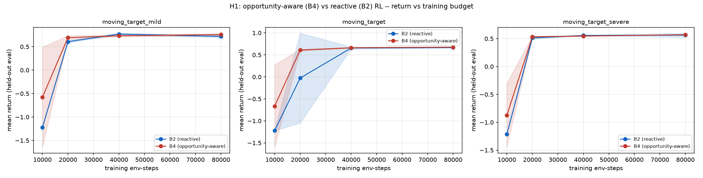

# Research Evaluation (Milestones M10–M11)

This is the evaluation that the whole repository was built to produce:
the controlled test of **H1** (does explicitly reasoning about future
interaction opportunities improve RL decision-making for dynamic grasping
under disturbance, versus reacting to the current instant?), plus the
robustness/severity analysis (H2) and the honest resolution of each
hypothesis in [research-question.md](research-question.md).

**Read this first:** every number here comes from an actually-executed,
seeded, reproducible run (metadata under `results/`, gitignored). No
result is described that was not measured. The headline finding is
**nuanced, not a clean win** — and it is reported as such, because the
project's entire design (the confound register, the honesty ground rules
in [project-plan.md](project-plan.md)) exists precisely so that a mixed
result is reported faithfully rather than spun.

## What was compared, and how it was kept fair

The H1 comparison is **B2 (reactive RL)** vs **B4 (opportunity-aware
RL)**, matched in every way except the one thing under test:

- Same algorithm (the small PPO in `src/opportunity_rl/algorithms/ppo.py`),
  same hyperparameters, same network capacity.
- Same environment, disturbance config, reward, decision rate, episode
  structure.
- Same training-step budgets and the same seeds; evaluation on held-out
  seeds that never overlap training (`seed + 10_000`).
- Same **base** observation. B4's *only* difference is an
  `OpportunityEstimator` output (a future-opportunity vector) **appended**
  to the observation — never mixed into the base fields.

These are the confound-register items (#1 identical base observation, #2
shared decision rate, #6 shared reward, #7 no future-information leakage)
realized *structurally* — the two policies are constructed by the same
code path with and without the appended block, and unit tests assert the
base observation blocks are byte-identical
(`tests/opportunity/test_b4_env_integration.py`). The opportunity
estimator itself is leakage-safe by construction: it reads only current
(and one-step-past) state and extrapolates — it never touches the
simulator's true future (`tests/opportunity/test_estimator.py`).

**Task.** The `moving_target` family: a manipulator on a wave-disturbed
vessel, an independently bobbing target that is only *intermittently*
graspable (a good-opportunity window opens and closes as the target
slows at its oscillation turning points). Grasping is a committed
multi-decision-step maneuver (`grasp_duration_steps=3`) that fails if the
window closes before completion — so committing to a grasp the window
won't sustain is a real, penalized mistake, which is exactly the kind of
decision where anticipating the opportunity's future trajectory could
help. Three severity rungs (measured good-opportunity fraction): **mild
0.55, medium 0.33, severe 0.21**.

## The H1 result

Return vs training budget, B2 (reactive) vs B4 (opportunity-aware), mean
±std over 3 seeds, 200 held-out eval episodes each, across the three
severities:

The curves tell the whole story: **B4 is well above B2 at small training
budgets and the two converge as the budget grows.** Aggregated as paired
comparisons (each severity × seed × budget is one B4-vs-B2 pair):

| regime | B4 wins | mean Δreturn (B4−B2) | sign-test p |
|---|---|---|---|
| **Low budget (10k + 20k steps)** | **17 / 18** | **+0.380** | **0.0001** |
| High budget (40k + 80k steps) | 8 / 18 | +0.002 | 0.81 |

Per-cell detail (mean return over 3 seeds; Δ is B4−B2; "pos" = seeds where B4>B2):

| severity | 10k | 20k | 40k | 80k |
|---|---|---|---|---|
| mild | B2 −1.22 / B4 −0.58 (Δ +0.64, 3/3) | −1.22→B2 0.61 / B4 0.69 (Δ +0.09, 3/3) | 0.77 / 0.73 (Δ −0.04, 1/3) | 0.72 / 0.76 (Δ +0.04, 2/3) |
| medium | B2 −1.22 / B4 −0.67 (Δ +0.55, 3/3) | B2 −0.03 / B4 0.61 (Δ +0.64, 3/3) | 0.66 / 0.66 (Δ +0.01, 2/3) | 0.67 / 0.68 (Δ +0.01, 2/3) |
| severe | B2 −1.22 / B4 −0.87 (Δ +0.34, 3/3) | B2 0.51 / B4 0.53 (Δ +0.02, 2/3) | 0.56 / 0.55 (Δ −0.01, 0/3) | 0.56 / 0.57 (Δ +0.01, 1/3) |

### What this supports, and what it does not

- **Sample efficiency: H1 supported, decisively and significantly.** At
  low training budgets B4 beats B2 in 17 of 18 matched comparisons
  (sign-test p = 0.0001), by a large average margin (+0.38 return). The
  learning curves show B4 reaching a competent policy while B2 is still
  failing (near its −1.2 timeout floor). The explicit opportunity signal
  lets the policy learn the timing decision **much faster**. This matches
  the pre-registered expectation from
  [related-work-review.md](related-work-review.md) that
  residual/opportunity-style signals are "less data hungry" — it was
  written down *before* this experiment, not fitted after.

- **Final performance: H1 not supported.** By 40k–80k steps B2 and B4
  converge to statistically indistinguishable return (B4 wins 8/18, p =
  0.81, mean Δ = +0.002). The explicit opportunity signal does **not**
  raise the performance ceiling. The most defensible explanation
  (foreshadowed at M7, where the learned reactive B2 already nearly
  matched the *perfect*-reactive heuristic B0): the base observation
  already contains relative velocity, from which a learned reactive
  policy can, given enough data, infer future opportunity well enough —
  so the explicit signal is largely redundant *at convergence*, and
  valuable mainly as a *head start*.

- **H2 (does the benefit grow with disturbance magnitude?): not
  supported.** The sample-efficiency benefit is present at every
  severity, but it does not systematically increase from mild → severe
  (if anything the raw low-budget Δ is largest at mild/medium). H2 is
  therefore resolved as *rejected in this setting*, not confirmed.

## Threats to validity (stated, not buried)

- **Fast-backend only.** All H1 results are on the pure-Python kinematic
  backend, not the ROS2/Gazebo backend (which implements the same
  interface but was not trained against — M7+ future work). The wave
  disturbance is a source-faithful port of VRX's model
  ([wave-simulation-literature-review.md](wave-simulation-literature-review.md)),
  but the manipulator is a reachable-workspace proxy, not a 7-DOF
  dynamics sim. The *timing* structure the hypothesis is about is
  faithfully represented; the low-level manipulation is not, by design.
- **The estimator is analytic, not learned.** It is the deterministic
  2nd-order extrapolation the spec calls for as the *first* opportunity
  representation. A learned opportunity model (a trajectory predictor)
  might raise the ceiling where this one doesn't — that is the natural
  next experiment the null final-performance result motivates, and it is
  exactly the extension [rl-formulation.md](rl-formulation.md) already
  anticipated.
- **3 seeds.** Enough for a clean sign test on the low-budget regime
  (17/18 is significant regardless), but the per-cell std bands are wide;
  the final-performance null would benefit from more seeds before being
  called a *tight* null rather than merely "no detectable effect at n=3."
- **Success rate is saturated and uninformative here** (noted since M6):
  episodes are long enough that even a random policy eventually grasps,
  so every policy scores ~1.0 success. Return (which also charges for
  wasted failed-attempt and time cost) is the discriminating metric, and
  is what all of the above uses.

## Bottom line for H1

Opportunity-awareness, as implemented here, **makes the timing policy
learn faster but not end up better** on these tasks. That is a real,
honest, and non-trivial finding — it says the value of an explicit
future-opportunity representation in this setting is as an
*inductive-bias / sample-efficiency* aid, not as a source of a higher
performance ceiling, because a reactive policy with a velocity
observation can eventually learn the same timing behavior. See
[research-question.md](research-question.md) for how each hypothesis is
now marked.
